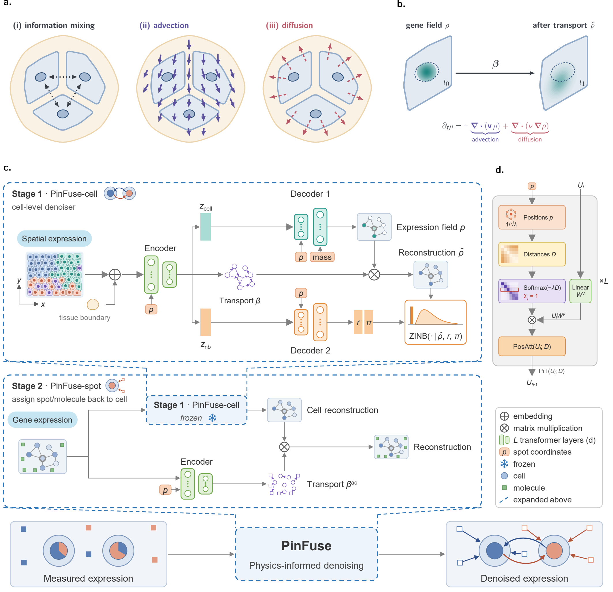

# PinFuse: Physics-informed Advection-diffusion Modeling for Subcellular Denoising of High-resolution Spatial Transcriptomics

**PinFuse** denoises sparse spatial transcriptomics counts with a graph variational
autoencoder over each spot's spatial neighbourhood. Attention weights are a learned
function of distance (positional-induced attention, PiT). Observed counts are
modelled as a denoised expression rate that has been transported by a learned,
neural advection-diffusion operator $\beta$.



Two models are provided:

| model | `model.type` | input | role |
|---|---|---|---|
| `PinFuse_Cell` | `pinfuse_cell` | cells, or spots / bins | single-level denoising (stage 1) |
| `PinFuse_Spot` | `pinfuse_spot` | cells + out-of-cell molecules / 2 µm bins | wraps a frozen `PinFuse_Cell` and learns how transcripts leak out of cells (stage 2) |

`PinFuse_Cell_Pyro` is the same model as `PinFuse_Cell`, written in Pyro and trained with SVI (`--use_pyro`).

## Repository layout

```
main.py         command line: train (or load a checkpoint), predict, save
train.py        model construction, training loops, checkpoint I/O
predict.py      inference passes (latent, denoised counts, flow, source cells)
dataio.py       data loading and preprocessing
datasets.py     spatial kNN graph and DGL neighbourhood batches
model/
  pinfuse_cell.py       PinFuse_Cell
  pinfuse_cell_pyro.py  PinFuse_Cell_Pyro
  pinfuse_spot.py       PinFuse_Spot
  layers.py             PiT attention layers, PiTFlow transport, MoG prior
  mutils.py             losses, LR schedule, checkpoint loading
config/         default_configs.py plus one config per dataset
```

## Installation

```bash
conda create -n pinfuse python=3.12
conda activate pinfuse
pip install torch==2.6.0 torchvision==0.21.0
pip install dgl==2.5.0+cu124 -f https://data.dgl.ai/wheels/torch-2.6/cu124/repo.html
pip install -r <(grep -v '^#' environment.txt | cut -d'#' -f1)
```

## Data

`--src_dir` accepts any of the following; `data.type` selects the format, and `'auto'` detects it:

- `adata`: a `.h5ad` file, or a folder containing one. The coordinates are read from `obsm[data.spatial_key]`.
- `sthd`: an STHD patch folder (needs the `STHD` package).
- `visiumhd`: a 10x Visium HD output folder (needs `spatialdata_io`), read at `data.bin_size`.
- `celllevel`: a folder holding a cell `.h5ad` (`data.cell_file`) and an out-of-cell `.h5ad` (`data.spot_file`). This is the input for `PinFuse_Spot`.

Token types come from `obsm['in_tissue']`, where 2 is a cell or in-tissue spot, 1 is ambiguous and 0 is out of tissue or out of cell.
If that key is missing, they are derived from `obs['cell_id']`, or from the H&E image in `uns['spatial']` when one is present.
Otherwise every spot is treated as in tissue.

## Training and prediction

```bash
python main.py --config config/xenium_configs.py \
    --src_dir data/xenium_tutorial.h5ad --dst_dir results/xenium
```

To skip training and predict with an existing checkpoint (for example, on a different crop):

```bash
python main.py --config config/xenium_configs.py \
    --src_dir data/xenium_tutorial.h5ad --dst_dir results/xenium_crop2 \
    --ckpt_dir results/xenium
```

The gene panel must match the checkpoint, including gene order.

Two-stage cell-level denoising first trains `PinFuse_Cell` on the cells, then
`PinFuse_Spot` on the joint object, with `model.pretrain_ckpt` pointing at the stage-1 run:

```bash
python main.py --config config/mousebrain_xenium_stage1_configs.py \
    --src_dir data/testdata/mouse_brain_xenium/adata_cell_with_celltype.h5ad \
    --dst_dir results/mousebrain_cellonly
python main.py --config config/mousebrain_xenium_stage2_configs.py \
    --src_dir data/testdata/mouse_brain_xenium --dst_dir results/mousebrain_stage2
```

Stage 2 must see stage 1's gene axis. Pin it with `data.gene_list` whenever
stage 1 selected highly variable genes (see `config/crop5_large_stage2_configs.py`).

Config values can be overridden on the command line, e.g. `--config.training.epochs=2 --config.model.lam5=0.1`.

Flags: `--ckpt_dir`, `--use_pyro`, `--[no]predict`, `--[no]extra`, `--[no]flow`,
`--[no]save_ckpt`, `--[no]save_adata`, `--num_sample`, `--count_dist {poisson,nb}`.

## Outputs

Under `--dst_dir`:

- `checkpoints/checkpoint.pth`: the trained model.
- `artifacts/config.json`: the resolved config.
- `artifacts/adata_denoised.h5ad`: the input AnnData with the predictions added.
- `logs/stdout.txt`

| field | content |
|---|---|
| `obsm['latent']` | latent representation |
| `obsm['predictions']` | denoised expression rate (before transport) |
| `obsm['reconstruct']` | rate after transport (the model of the observed counts) |
| `obsm['predictions_count']`, `obsm['reconstruct_count']` | counts sampled from the two (Poisson / NB and ZINB) |
| `obsm['dropout']`, `obsm['dispersion']` | ZINB parameters |
| `obsm['direction']`, `obsm['direction_tol']` | per-gene and gene-averaged net flow vector |
| `obs['log_diffusivity']` | learned diffusivity |
| `obsm['source_cell_gene_idx']`, `obsm['source_cell_gene_prob']` | `PinFuse_Spot`: source cell of each detected gene of each out-of-cell token |
| `obs['source_cell']`, `obs['source_cell_prob']` | `PinFuse_Spot`: source cell of each token's dominant gene |

## Python API

The step-by-step tutorial is in `tutorial/pinfuse_xenium_tutorial.ipynb`.

A minimal script using the same building blocks:

```python
import scanpy as sc
from config.xenium_configs import get_config
from dataio import from_anndata
from predict import predict_all
import train

config = get_config()

# 1. Load data (sc.read downloads xenium_tutorial.h5ad once from figshare)
adata = sc.read("data/xenium_tutorial.h5ad",
                backup_url="https://figshare.com/ndownloader/files/49710699")
adata.X = adata.layers["counts"]

# 2. Preprocess according to the config (crop, spatial key, ...)
data = from_anndata(config, adata)

# 3. Build and train PinFuse_Cell
n_obs, n_gene = data.shape
model = train.build_model(config, n_gene=n_gene, n_obs=n_obs)
model = train.fit(config, data, model=model, dst_dir="results/xenium")

# 4. Predict: latent, denoised rate, sampled counts, flow field
adata_den = predict_all(config, data.adata, model)
# adata_den.obsm["latent"], ["predictions"], ["reconstruct"], ...
```

Or use `train.run` to do all four steps in one call:

```python
from config.xenium_configs import get_config
import train

config = get_config()
data, model = train.run(config, "data/xenium_tutorial.h5ad", "results/xenium")
adata = data.adata
```
